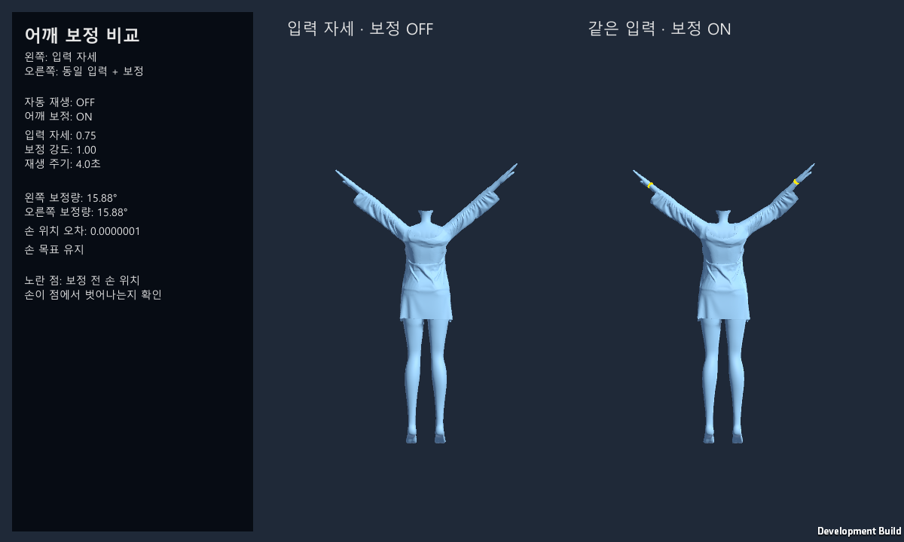

# Warudo Shoulder Correction

팔을 올리거나 앞으로 뻗을 때 쇄골 회전을 보정하고 손 위치를 유지하는 Warudo 플러그인입니다. 별도의 보정 키프레임 없이 입력 자세에 필요한 회전을 더합니다.

Unity 비교 씬과 Warudo 빌드 설정을 포함합니다. **Unity 테스트와 모드 빌드에는 Warudo 설치가 필요하지 않습니다.**

## 시작하기

1. Windows에서 저장소 전체를 ZIP으로 내려받아 압축을 풀거나 Git으로 복제합니다. Unity Hub에서 `Assets`, `Packages`, `ProjectSettings`가 들어 있는 최상위 폴더를 추가합니다.
2. 이 프로젝트를 **Unity 2021.3.45f2**로 엽니다. 최초 패키지 복원에는 Git과 인터넷 연결이 필요합니다.
3. 패키지 복원과 컴파일을 기다립니다. Built-in Render Pipeline / .NET Framework 설정을 유지합니다. 빌드 경로는 현재 프로젝트 위치에 맞춰 자동 설정됩니다.
4. `Portfolio > Open Interactive Demo Scene`으로 `Assets/Demo/ShoulderDemo.unity`를 열고 **Play**를 누릅니다.
5. 왼쪽 캐릭터의 입력 자세와 오른쪽 캐릭터의 보정 결과를 비교합니다. 팔 움직임은 자동 재생됩니다.

노란 점은 보정 전 손 위치를 나타냅니다. 정보 패널에는 보정량과 손 위치 오차가 표시됩니다. 설정은 Inspector에서 조절합니다. Game 창은 1200×720 또는 16:9를 권장합니다.

프로젝트를 열면 `Packages/manifest.json`에 지정된 버전의 Warudo SDK가 자동으로 설치됩니다. SDK를 따로 설치하거나 자산을 빈 프로젝트로 옮길 필요는 없습니다. Unity Console에 컴파일 오류가 없는지 확인한 뒤 진행합니다. Warudo에서 실행하려면 Warudo를 별도로 설치해야 합니다.

## Warudo로 가져가기

Warudo용으로 빌드되는 파일은 **어깨 보정 플러그인 한 개**입니다. Unity 비교 씬의 FBX는 캐릭터 모드로 빌드되지 않으므로, Warudo에서는 쇄골과 양팔이 매핑된 **Humanoid 캐릭터(VRM 또는 캐릭터 `.warudo`)**가 필요합니다. 젖음 시스템 저장소의 `WetnessDemoCharacter.warudo`도 사용할 수 있습니다.

### 빌드와 파일 설치

직접 빌드하지 않고 테스트하려면 [제공된 ShoulderCorrection.warudo](WarudoDemo/ShoulderCorrection.warudo)를 데이터 폴더의 `Plugins`에 복사하고 Warudo를 다시 실행합니다. 캐릭터와 젖음 테스트 씬은 [젖음 시스템 저장소의 제공 파일](https://github.com/negu63/warudo-wetness-system#warudo로-가져가기)을 사용할 수 있습니다. 플러그인·캐릭터 설치 후 첨부된 씬 JSON을 가져오면 빠르게 테스트를 시작할 수 있으며, 어깨 보정은 아래 절차대로 에셋을 추가해 연결합니다.

1. Unity에서 Play 모드를 종료하고 **`Portfolio > Build All Mods`**를 실행합니다.
2. Console의 `[Portfolio] MOD BUILD PASSED 0` 메시지와 `Exports/ShoulderCorrection/ShoulderCorrection.warudo`를 확인합니다. `Exports`는 이 Unity 프로젝트의 최상위 폴더에 생성됩니다.
3. Warudo 편집 창의 **`Menu > Open Data Folder`**로 데이터 폴더(`StreamingAssets`)를 엽니다. 자세한 내용은 [공식 데이터 폴더 안내](https://docs.warudo.app/docs/tutorials/data-folder)를 참고합니다.
4. Warudo를 종료하고 `ShoulderCorrection.warudo` 파일을 데이터 폴더 안의 **`Plugins`**에 복사합니다. 준비한 캐릭터 파일은 **`Characters`**에 넣습니다. Warudo를 다시 실행합니다.

### 모캡 없이 보정 비교

1. Warudo의 **`Add Asset`** 메뉴에서 **Character** 에셋을 추가하거나 기존 Character 에셋을 선택합니다. **`Source`**에서 준비한 캐릭터를 선택합니다. [공식 Character 안내](https://docs.warudo.app/docs/assets/character)를 참고할 수 있습니다.
2. **`Add Asset`** 메뉴에서 **자동 어깨 보정** 에셋을 추가합니다. **`대상 캐릭터`**에 앞에서 불러온 Character 에셋을 지정합니다. 같은 캐릭터에는 어깨 보정 에셋 하나만 연결합니다.
3. Camera 에셋으로 캐릭터의 상체와 양손이 보이도록 구도를 맞춥니다. 비교 중 자세가 움직이지 않도록 캐릭터에 연결된 모캡 입력과 다른 자세 구동은 일시적으로 끕니다.
4. **`팔 올리기 테스트 (모캡 없이)`**를 켜고 **`테스트 재생`**을 끕니다. **`테스트 고정 자세`**를 `0.75`로 설정합니다. **`보정 강도`**는 `1`로 둡니다.
5. **`보정 사용`**을 OFF/ON으로 바꾸면서 쇄골과 어깨의 회전을 비교합니다. ON일 때 **`상태`**에는 왼쪽·오른쪽 보정 각도가 표시됩니다. Warudo에서는 노란 손 목표 표시 대신 캐릭터의 양손 위치와 어깨 모양을 직접 비교합니다.
6. **`테스트 재생`**을 켜고 팔을 올리고 내리는 동안의 보정을 확인합니다. 실제 애니메이션·모캡을 테스트할 때에는 **`팔 올리기 테스트 (모캡 없이)`**를 끈 뒤 해당 입력을 다시 켭니다. 래그돌 중에는 보정이 중단됩니다.

### 모캡·물총과 함께 사용하기

**Warudo 모캡, 자동 어깨 보정, WaterGun은 함께 사용할 수 있습니다.** 모캡 연동은 **RhyLive 환경에서 테스트했습니다.** 연결 방법은 [Warudo의 RhyLive 안내](https://docs.warudo.app/docs/mocap/rhylive)를 참고합니다.

**`팔 올리기 테스트 (모캡 없이)`는 어깨 보정을 비교하는 전용 동작이며 WaterGun과의 동시 사용은 지원하지 않습니다.** 물총 테스트 시에는 이 기능을 끄고 일반 애니메이션 또는 모캡 입력을 사용합니다.

모캡을 사용할 때에는 **`팔 올리기 테스트 (모캡 없이)`를 끄고**, **`보정 사용`**을 켠 뒤 모캡 입력을 연결합니다. WaterGun도 사용하는 경우 두 에셋의 **`대상 캐릭터`**를 같은 Character로 지정합니다. 물총의 표면 등록과 분사 설정은 젖음 시스템 저장소의 README를 따릅니다.

기본값은 강도 1, 시작 -30도, 최대 들림 25도, 앞으로 보정 15도, 부드러움 0.08초입니다.

빌드 경로는 프로젝트 위치에 맞춰 자동으로 갱신됩니다. 모드 이름·버전·아이콘·선택은 유지됩니다. 개별 빌드는 `Warudo > Switch Active Mod...`에서 ShoulderCorrection을 선택한 뒤 `Warudo > Build Mod`로 실행합니다. 경로를 다시 설정할 때에는 `Portfolio > Configure Mod Exports`를 사용합니다.

모드 빌드 결과는 `Exports`, Unity 실행 파일과 검사 결과는 `Artifacts`에 저장됩니다.

## 주요 구현

- **본 축 차이:** 몸통 기준 팔 방향으로 들림·앞쪽 회전을 계산합니다.
- **입력 자세 보존:** 이미 입력된 쇄골 회전을 고려해 부족한 회전만 추가합니다.
- **손 위치 유지:** 상완과 하완으로 이루어진 두 본의 IK를 해석적으로 풀고 손 회전을 보존합니다. 팔 길이는 유지하며, 목표 손 위치에 도달할 수 없으면 보정량을 줄입니다.
- **프레임 간 누적:** 자신의 이전 보정만 복원하고 다른 입력이 덮어쓴 자세는 보존합니다.
- **Warudo 연결:** FullBodyBipedIK를 사용하면 OnPreRead에서, IK를 사용하지 않으면 OnPostLateUpdate에서 보정합니다. 대상 변경·삭제, 중복 연결, 래그돌 상태에 따라 보정을 갱신하거나 중단합니다.

## Unity에서 설정과 검사

Unity 데모에는 `ShoulderCorrectionRig`가 연결되어 있습니다. `Shoulder Demo` 컴포넌트의 Inspector에서 `Correction`, `Strength`, `Playing`, `Pose`를 조절합니다. 고정 자세를 비교하려면 `Playing`을 끕니다.

| Unity 메뉴 | 확인 내용 / 출력 |
|---|---|
| `Portfolio > Run Validation` | 양팔 굽힘 20조건 → `Artifacts/test-pose-validation.json`, Humanoid 5자세·손 위치·500프레임 복원·강도 0 → `Artifacts/validation.json` |
| `Portfolio > Verify Interactive Demo Scene` | 열린 데모 씬의 스크립트·Humanoid 참조 검사 |
| `Portfolio > Build Interactive Demo` | Windows 실행 파일 → `Artifacts/InteractiveDemo` |

## 문제가 발생할 때

| 증상 | 확인할 내용 |
|---|---|
| Unity에 Portfolio 메뉴가 없거나 빌드가 시작되지 않습니다. | 패키지 복원 완료와 Console의 첫 컴파일 오류를 확인합니다. Git 설치 후 Unity를 다시 열어야 할 수 있습니다. 경로 오류라면 `Portfolio > Configure Mod Exports`로 다시 설정합니다. |
| SDK 예외 로그가 표시됩니다. | Console의 첫 오류와 빌드 성공 메시지, 출력 파일을 확인합니다. 성공 메시지가 없거나 빌드가 중단되면 실패로 처리합니다. |
| 자동 어깨 보정 에셋이 없습니다. | 파일이 실제 데이터 폴더의 `Plugins`에 있는지 확인하고 Warudo를 재시작합니다. |
| Humanoid 관련 상태 메시지가 표시됩니다. | 대상 캐릭터에 쇄골·상완·하완·손 본이 매핑되어 있는지 확인합니다. Unity 씬의 FBX를 그대로 Characters에 복사하는 것으로는 불러올 수 없습니다. |
| 중복 연결 메시지가 표시됩니다. | 같은 캐릭터를 지정한 다른 어깨 보정 에셋의 연결을 해제합니다. |
| 보정 차이가 보이지 않습니다. | 대상·보정 사용·강도·테스트 고정 자세를 확인하고 래그돌 및 다른 자세 입력이 비교를 방해하는지 확인합니다. |
